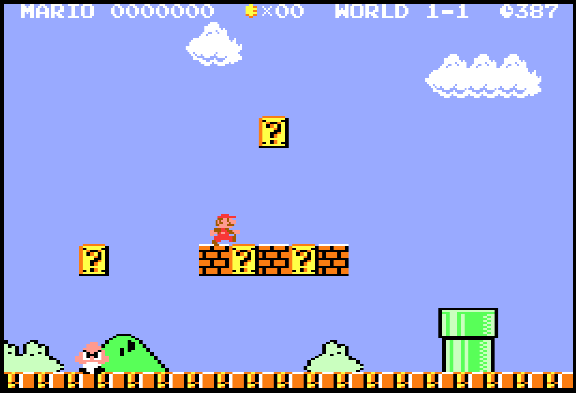

# smb-kawari.patch

Turns the original (v1.0) `super m. bros.64` PRG into the VIC-II Kawari build
(`build/smb-kawari.prg`).  The patch holds only the differences: 2,989 bytes,
none of the original game.

# What changes?

FPS slowdowns eliminated.
Pipes and bushes updated to look closer to original SNES version.

NOTE: Kawari firmware 1.20 or higher is required to run this software.

| file | SHA-256 |
|---|---|
| input: `super m. bros.64` (48,564 bytes) | `ea4a4be2fee56bf17ac72e7076081d64842e56e387c91bd80cbda2e478241a7e` |
| output: `smb-kawari.prg` (51,062 bytes) | `04b509077b6d9feff7ff44c22c94762c5b2cf54e1c4868fa2104b23a03b85f87` |

You will need VICE's c1541 tool installed.

## Extract the prg from v1.0 of ZeroPaige's .d64

    c1541 -attach 'Super Mario Bros 64 v1.0 (2019-04-18)(Zeropaige).d64' -read 'super m. bros.64'

## Apply the patch

Needs Python 3.6 or later, no extra packages.

    python3 apply_patch.py 'super m. bros.64' smb-kawari.patch smb-kawari.prg

The input is checked against the first checksum and the result against the
second, so the output is either byte-exact or nothing is written.  The input
file is only read.

## Put the image back to a new .d64 file

    c1541 -format 'kawari-smb,00' d64 kawari-smb-pal.d64
    c1541 -attach kawari-smb-pal.d64 -write smb-kawari.prg

